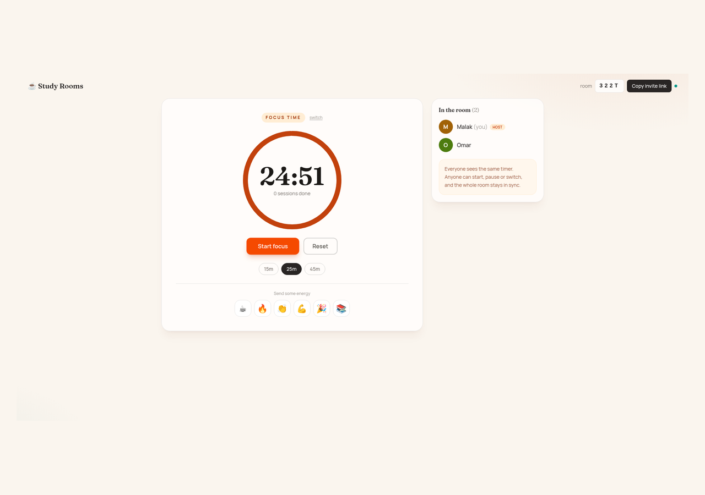

# Study Rooms

Shared Pomodoro rooms, synced live. Create a room, send the code or invite link, and everyone studies on the same timer. No sign-up, no database, just a link.



**Live demo:** https://malakmo7amed309.github.io/study-rooms/

## Standout feature

One timer for the whole room. Anyone in the room can start, pause, reset or switch between focus and break, and every connected client stays in sync in real time. Live presence shows who is studying with you, and you can send emoji energy to the room.

## How it works

- Rooms are identified by a short code in the URL hash (`#room=322T`), so a room is just a link you can paste anywhere.
- Sync runs on **Supabase Realtime**: presence tracks who is in the room, and broadcast messages carry every timer action with a revision number so all clients converge on the same state.
- The eldest connected client owns advancing the timer, so the room keeps ticking even if the person who started it leaves.
- No database tables and no accounts: everything lives in realtime channels.

## Stack

- React + Vite
- Tailwind CSS v4
- Supabase Realtime (presence + broadcast)
- Fraunces + Manrope type, warm study-cafe palette

## Run locally

```bash
npm install
npm run dev
```

The production build is a single self-contained `docs/index.html`, deployed to GitHub Pages from the `docs/` folder.
